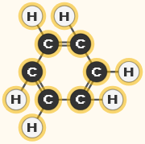
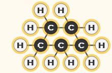
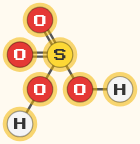

Atoms are balls with **hands**. Put atoms next to each other and they hold
hands by themselves. When **every** hand in a molecule is holding another one,
it's finished: it glows, the room says its name, and it goes in the 📖 book.

| Atom | Color | Hands |
|---|---|---|
| ⚪ H hydrogen | white | 1 |
| 🔴 O oxygen | red | 2 |
| ⚫ C carbon | black | 4 |
| 🔵 N nitrogen | blue | 3 |
| 🟢 Cl chlorine | green | 1 |
| 🟡 S sulfur | yellow | 2 (tap it with 🔗 for 4, then 6) |
| 🍏 F fluorine | pale green | 1 |
| 🟤 Br bromine | dark red | 1 |
| 🟣 I iodine | purple | 1 |
| 🍑 B boron | salmon | 3 |
| 🟫 Si silicon | tan | 4 |
| 🟠 P phosphorus | orange | 3 (tap it with 🔗 for 5) |

The colors are the ones real molecule-model kits use. F and Cl are both green:
the letter on the ball tells them apart.

## The board

The board is a honeycomb: six-sided cells in rows, every other row pushed half
a cell over, so **each cell touches six others** (left, right, two above, two
below). That means rings of any size fit.

| Tool | What it does |
|---|---|
| 🧱 PLACE | Tap or drag to put the chosen atom down |
| ⛏️ REMOVE | Tap or drag to take atoms away |
| 🔗 BOND | Tap between two atoms, or slide from one atom onto one touching it: one more stick (double, triple bonds). When they can't take more sticks, it pulls them apart, and the next time joins them again. **Tap right on the middle of a sulfur or phosphorus** to give it two more hands (S 2 → 4 → 6 → 2, P 3 → 5 → 3; it can only go back down if those hands are free). While your finger is down the atoms glow with what will happen (🔗 one more stick, ✂️ pull apart, ✋ more hands, ✊ fewer hands, 🚫 can't change); it happens when you lift your finger, so slide off to change your mind |

## Rings

- **A ring of 3:** three cells that all touch each other close up by themselves.
- **A ring of 6** (benzene) is a hexagon of carbons around one empty cell.
  Tap every other bond with 🔗 to make the double bonds, then add the H's.

  

- **A ring of 5** (like the one in DMT, pyrrole or furan): put three atoms in a
  row and two above them. The middle one of the three touches all four others,
  so it grabs hands across the ring. Pull it apart from the two above it with
  🔗 (sometimes the second pull makes a double bond first: tap again).

  

## Name cards and the book

- 📖 a molecule from the book (with a fun fact), 🌟 a real molecule with its
  real chemistry name ("super rare!"), 💡 a molecule nobody has named: your
  invention. ⏳ means "no internet yet, I'll look it up later".
- **Big molecules** (more than 8 atoms that aren't H): the room asks
  [PubChem](https://pubchem.ncbi.nlm.nih.gov) on the internet. If PubChem
  knows it, you get its real name (DMT, caffeine, melatonin…); if not, it's
  your invention. If PubChem's main name is a chemist's name full of numbers
  ("3-(1-Methylpyrrolidin-2-yl)pyridine"), the room looks through its other
  names for the everyday one ("Nicotine"). With no internet it waits ⏳ and asks again later.
- **Naming your molecules:** open the 📖 book, go to 💡 or 🌟, and tap a
  molecule. Its window shows it big: 🔊 says its name, ✏️ lets you type a new
  name (up to 30 letters), ✅ saves it. Make it again and the card uses your
  name. A 🌟 you renamed keeps its real name in small letters under yours;
  type the real name again to put it back. If PubChem later finds out an
  invention is a real molecule, it moves to 🌟 and keeps your name too.
- **Unlocking:** start with H and O. 💧 Water unlocks ⚫ C. Three carbon
  molecules unlock 🔵 N. Two nitrogen molecules unlock 🟢 Cl and 🟡 S. Two
  molecules with Cl or S unlock 🍏 F, 🟤 Br and 🟣 I. Two molecules with F, Br
  or I unlock 🍑 B, 🟫 Si and 🟠 P.
- **Crowding:** H atoms take up a cell, so some shapes don't fit. A hand with
  no room left turns red and squished, with a 💥. Move something!
- **Sulfur's extra hands:** sulfuric acid is a sulfur with 6 hands: two double
  bonds to O, and two O–H.

  

- **Grown-ups (⚙️):** unlock every atom, or erase the book.

The big name list comes from [PubChem](https://pubchem.ncbi.nlm.nih.gov)
(public domain, from the US National Library of Medicine): every molecule
with up to 8 non-H atoms that fits on the board. See `tools/chem-db/README.md`
to remake it.
